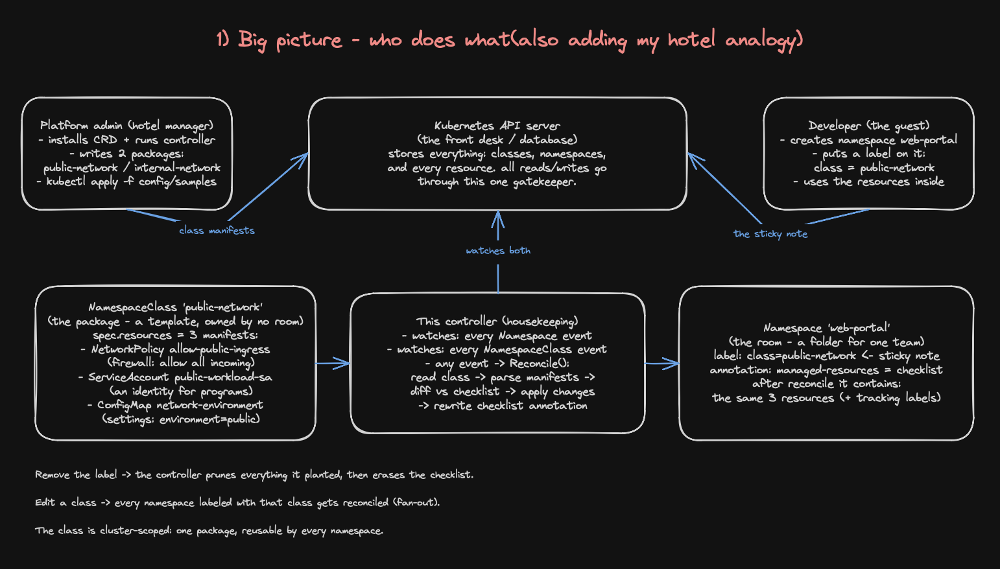
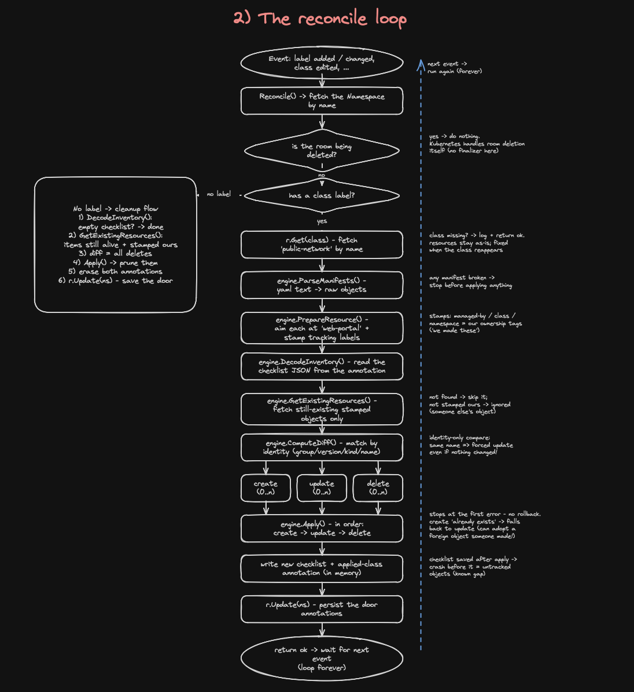
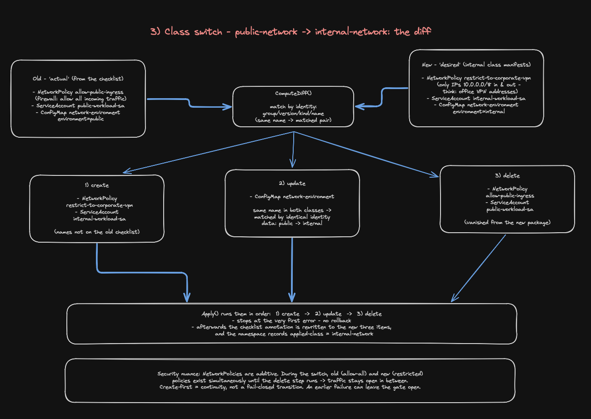
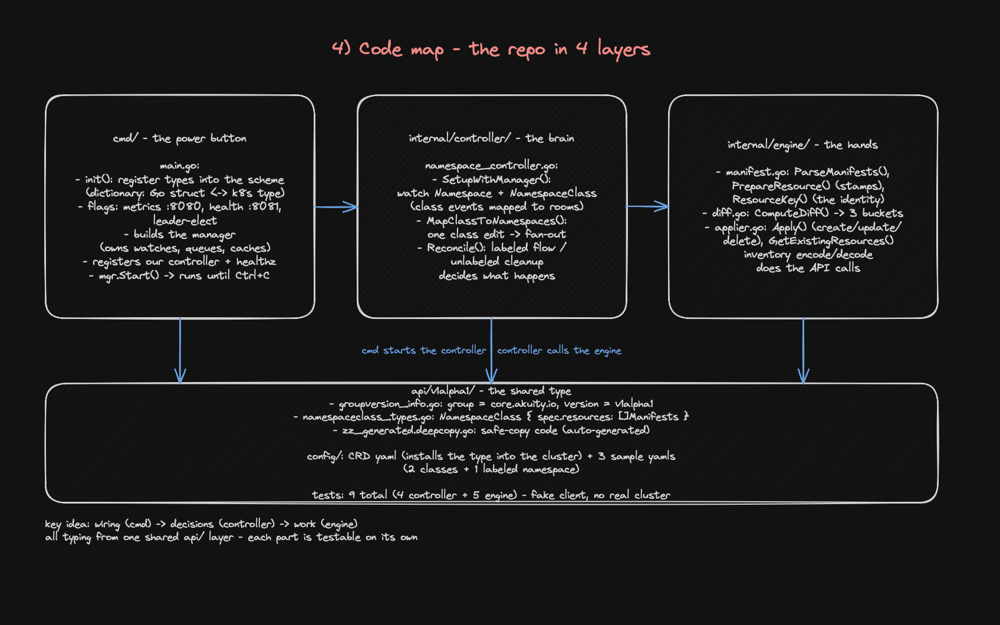

# namespace-controller

a simple kubernetes controller that manages baseline resources across namespaces using a custom `NamespaceClass` crd and namespace labels.

instead of manually copy-pasting things like network policies, service accounts, and config maps into every new namespace, an admin defines a `NamespaceClass` once. any namespace labeled with that class will automatically have those resources created, updated, and kept in sync. if the class changes or the namespace switches to another class, the controller updates or cleans up the resources automatically.

## contents

1. [what it does](#what-it-does)
2. [how it works](#how-it-works)
3. [requirements](#requirements)
4. [quick start](#quick-start)
5. [how reconciliation works](#how-reconciliation-works)
6. [project layout](#project-layout)
7. [design decisions and trade-offs](#design-decisions-and-trade-offs)
8. [known limitations and next steps](#known-limitations-and-next-steps)
9. [testing](#testing)

## what it does

in multi-tenant clusters, setting up namespaces usually requires creating the same base resources every time, like firewall rules, service accounts, and config maps. doing this manually or via copy-paste leads to configuration drift.

this project solves that by making namespace setups reusable:

1. define a class once (for example, `public-network` or `internal-network`).
2. label a namespace with `namespaceclass.akuity.io/name: <class-name>`.
3. the controller watches the namespace and makes sure its resources match the class definition.

two sample classes are included in `config/samples/`:

- `public-network`: creates a network policy allowing public ingress, a `public-workload-sa` service account, and a config map setting `environment: public`.
- `internal-network`: creates a network policy restricting traffic to corporate vpn cidr (`10.0.0.0/8`), an `internal-workload-sa` service account, and a config map setting `environment: internal`.

### what it is not

- it is not a workload deployment tool (it doesn't deploy app pods or helm charts).
- it is not a full gitops engine replacement.
- the sample network policies are basic examples and need a cluster with a cni that enforces policies (like calico or cilium) to take effect.

## how it works



- `NamespaceClass` is a cluster-scoped crd. its `spec.resources` accepts a list of raw kubernetes manifests (any valid kubernetes resource kind).
- a namespace picks a class using a label: `namespaceclass.akuity.io/name: <class-name>`.
- the controller watches both `Namespace` and `NamespaceClass` objects. when an event fires, it parses the class manifests, compares them with what currently exists, and creates, updates, or deletes resources as needed.
- it tracks what it manages by saving an inventory list in a namespace annotation (`namespaceclass.akuity.io/managed-resources`).
- every created child resource gets stamped with labels so we know our controller owns it.

### metadata keys used

here are the labels and annotations the controller uses to track things:

- `namespaceclass.akuity.io/name` (namespace label): selects which class the namespace uses.
- `namespaceclass.akuity.io/managed-resources` (namespace annotation): stores a json inventory of resources created by the controller.
- `namespaceclass.akuity.io/applied-class` (namespace annotation): records the name of the last applied class.
- `app.kubernetes.io/managed-by: namespaceclass-controller` (child resource label): marks a resource as managed by this controller.
- `namespaceclass.akuity.io/class` (child resource label): records which class created the resource.
- `namespaceclass.akuity.io/namespace` (child resource label): records the target namespace.

## requirements

- go 1.26 or higher (see `go.mod`).
- a running kubernetes cluster and working `kubeconfig` with permissions to manage namespaces, custom resource definitions, and the resources listed in your classes (`kubectl cluster-info` to check).
- `kubectl` installed.
- for network policy enforcement, a cluster network plugin (cni) supporting network policies.

the controller uses standard controller-runtime config loading: it reads your local `kubeconfig` when run locally, or in-cluster service account tokens when deployed in a pod.

## quick start

run the controller locally and apply the sample resources.

### 1. install the crd and start the controller

```bash
# check cluster connection
kubectl cluster-info

# install the NamespaceClass CRD
kubectl apply -f config/crd/core.akuity.io_namespaceclasses.yaml
kubectl wait --for=condition=Established --timeout=60s crd/namespaceclasses.core.akuity.io

# run the controller locally (keep running in this terminal)
go run ./cmd
```

### 2. apply samples and test in a second terminal

```bash
# create the classes and a labeled test namespace
kubectl apply -f config/samples/01_public_network_class.yaml
kubectl apply -f config/samples/02_internal_network_class.yaml
kubectl apply -f config/samples/03_sample_namespace.yaml

# check what got created inside the web-portal namespace
kubectl get namespaceclasses
kubectl get namespaces web-portal -o yaml
kubectl get networkpolicies,serviceaccounts,configmaps -n web-portal

# switch the namespace to the internal-network class
kubectl label namespace web-portal namespaceclass.akuity.io/name=internal-network --overwrite

# verify that public resources were pruned and internal resources were created
kubectl get networkpolicies,serviceaccounts,configmaps -n web-portal

# remove the label to clean up all managed resources
kubectl label namespace web-portal namespaceclass.akuity.io/name-
```

### startup flags

- `--metrics-bind-address` (default `:8080`): prometheus metrics endpoint.
- `--health-probe-bind-address` (default `:8081`): health and readiness probe endpoint.
- `--leader-elect` (default `false`): enables leader election for multi-replica setups (keep false for local runs).

## how reconciliation works

the controller is idempotent. it never assumes a previous step succeeded, and instead reconciles the current cluster state against the desired state on every run.



### 1. labeled namespace workflow

when a namespace has `namespaceclass.akuity.io/name: <class>`:

1. fetch the namespace. skip if it doesn't exist or is terminating.
2. fetch the referenced `NamespaceClass`. if the class is not found, log a message and exit cleanly without breaking existing resources.
3. call `engine.ParseManifests` to decode raw bytes from `spec.resources` into dynamic unstructured objects.
4. call `engine.PrepareResource` to set `metadata.namespace` and stamp the tracking labels.
5. call `engine.DecodeInventory` to read what was previously created from the namespace's annotation.
6. call `Applier.GetExistingResources` to fetch current cluster objects that match the inventory and carry our `managed-by` label.
7. call `engine.ComputeDiff` to compare desired vs actual objects by identity (`group/version/kind/name`).
8. call `Applier.Apply` to execute changes in order: creates first, then updates, then deletes (pruning).
9. update the namespace inventory annotation and applied-class annotation with the new list.



### 2. unlabeled namespace workflow

when a namespace has no class label (or the label was removed):

1. read the inventory annotation on the namespace.
2. if resources are listed, fetch and delete them.
3. remove the inventory and applied-class annotations from the namespace.

### 3. class update workflow

when an admin updates a `NamespaceClass`:

1. the controller uses `handler.EnqueueRequestsFromMapFunc` (`MapClassToNamespaces`) to watch `NamespaceClass` objects.
2. it queries all namespaces labeled with that class name and queues reconcile requests for each of them.
3. every namespace using that class reconciles against the updated definition.

## project layout



```
.
├── cmd/
│   └── main.go                          # entry point: manager setup, flags, health checks
├── api/
│   └── v1alpha1/
│       ├── groupversion_info.go         # api group and version registration
│       ├── namespaceclass_types.go      # go structs for NamespaceClass
│       └── zz_generated.deepcopy.go     # generated deepcopy methods for runtime.Object
├── internal/
│   ├── controller/
│   │   ├── namespace_controller.go      # reconciler loop, watch mappers, cleanup
│   │   └── namespace_controller_test.go # reconciler unit tests with fake client
│   └── engine/
│       ├── manifest.go                  # raw manifest parsing and namespace injection
│       ├── diff.go                      # identity-based diff calculation
│       ├── applier.go                   # k8s client crud operations and inventory helpers
│       └── engine_test.go               # engine unit tests
├── config/
│   ├── crd/
│   │   └── core.akuity.io_namespaceclasses.yaml # crd manifest
│   └── samples/
│       ├── 01_public_network_class.yaml         # public network class sample
│       ├── 02_internal_network_class.yaml       # internal network class sample
│       └── 03_sample_namespace.yaml             # sample labeled namespace
├── docs/
│   └── images/                          # architecture diagrams
├── go.mod
├── go.sum
└── README.md
```

## design decisions and trade-offs

- **controller instead of scripts**: a controller automatically reacts to class edits and label changes to keep cluster state in sync over time. the trade-off is that it has to handle retries, eventual consistency, and error states.
- **controller-runtime framework**: standard k8s library that gives us informers, work queues, watches, and a fake client for testing. the trade-off is needing to understand framework caching and reconciliation semantics.
- **raw manifests with runtime.RawExtension**: allows a class to contain any resource kind without hardcoding go structs. the trade-off is less compile-time schema validation, relying on the api-server to validate fields at runtime.
- **cluster-scoped crd**: templates are global and shared across teams, similar to `StorageClass`. the trade-off is that changing a class affects all namespaces using it.
- **label-based namespace selection**: uses familiar `kubectl` metadata workflows without needing extra binding crds. the trade-off is labels cannot easily carry parameters or overrides.
- **inventory in namespace annotation**: tracks created resources right on the namespace without extra databases. the trade-off is annotation size limits, though standard classes are well within limits.
- **tracking labels instead of owner references**: keeps lifecycle clean without cross-namespace ownerReference limitations. the trade-off is deletion is handled by controller diffing rather than k8s garbage collection.
- **create before delete on class switch**: ensures new resources exist before tearing down old ones. the trade-off is old and new resources coexist for a brief moment during a switch.

## known limitations and next steps

trade-offs noted for the scope of this project:

- **resource adoption on collision**: if a resource with the same name already exists in the namespace before the class is applied, the controller will update it rather than erroring out. in production, we would add an ownership check before modifying existing resources.
- **field synchronization**: updates currently sync labels, annotations, `spec`, and `data`. for kinds with custom top-level fields (like `Role` with `rules`), extending this with server-side apply (ssa) would handle arbitrary field sets better.
- **drift detection**: child resources are reconciled when the namespace or class changes. adding watches on child resources with an owner label would allow repairing drift if someone manually edits or deletes a child resource.
- **packaging**: currently runs via `go run` or compiled binary. next steps would include a dockerfile, helm chart, and rbac manifests for in-cluster deployment.

## testing

all unit tests use `controller-runtime`'s fake client and run without needing a live cluster:

```bash
# run all unit tests
go test -v ./...

# run with coverage
go test -cover ./...

# run static checks
go vet ./...
```

the tests cover:
- creating resources for a labeled namespace
- switching a namespace from one class to another with pruning of old resources
- unlabeling a namespace and verifying complete cleanup
- mapping class updates to all matching namespaces
- raw manifest parsing, namespace injection, label stamping, diff computation, and inventory encoding
